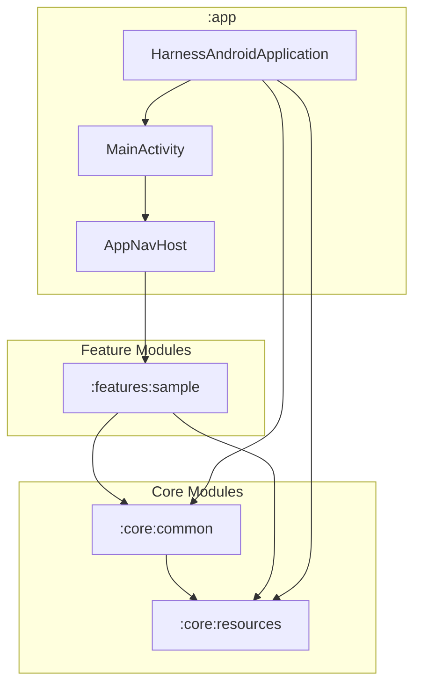
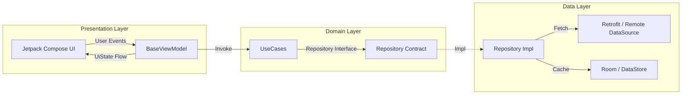
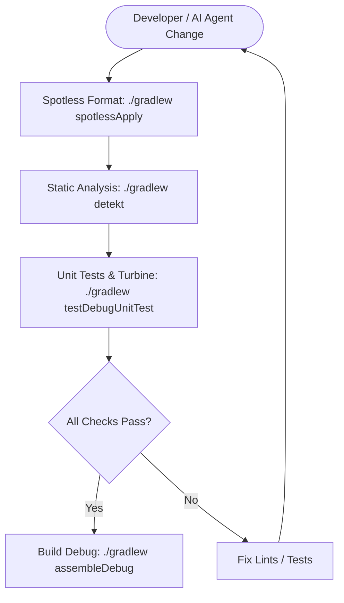

# HarnessAndroid — Production-Grade Android Base Architecture & Agent Harness

> **Harnessing ANDroid Software Craftsmanship with Agentic AI.**

Welcome to **HarnessAndroid**, a robust, production-grade, multi-module Android project template engineered for scalability, testability, and strict architectural compliance. This repository serves as a reference base for building professional Android applications from scratch using modern Android development best practices, Clean Architecture, Jetpack Compose, Material 3, and an integrated AI Agent engineering harness.

---

## 📊 Architecture & System Infographic

### 1. High-Level System Architecture


### 2. Multi-Module Topology & Dependency Matrix

| Module | Depends On | Description |
| :--- | :--- | :--- |
| **`:app`** | All Core & Feature modules | Entry point, Koin initialization, Central NavHost |
| **`:core:common`** | `:core:resources` | Base abstractions (`BaseViewModel`, `Resource<T>`, `UiText`, safe API calls) |
| **`:core:resources`** | None | Design system (Material 3 Themes, Colors, Typography, Strings) |
| **`:features:*`** | `:core:common`, `:core:resources` | Scalable feature modules (Domain, Data, Presentation). **No horizontal dependencies between features.** |

### 3. Clean Architecture & MVVM + UDF Layer Flow


### 4. Quality Harness & Verification Pipeline


---

## 📊 Architecture & System Infographic

### 1. High-Level System Architecture


### 2. Multi-Module Topology & Dependency Matrix

| Module | Depends On | Description |
| :--- | :--- | :--- |
| **`:app`** | All Core & Feature modules | Entry point, Koin initialization, Central NavHost |
| **`:core:common`** | `:core:resources` | Base abstractions (`BaseViewModel`, `Resource<T>`, `UiText`, safe API calls) |
| **`:core:resources`** | None | Design system (Material 3 Themes, Colors, Typography, Strings) |
| **`:features:*`** | `:core:common`, `:core:resources` | Scalable feature modules (Domain, Data, Presentation). **No horizontal dependencies between features.** |

### 3. Clean Architecture & MVVM + UDF Layer Flow


### 4. Quality Harness & Verification Pipeline


---

## 1. Architecture & Design Principles

The project adheres strictly to **Clean Architecture** combined with **MVVM (Model-View-ViewModel)** and **Unidirectional Data Flow (UDF)**:
- **Domain Layer (`domain/`)**: Pure Kotlin business logic. Completely independent of Android framework APIs, databases, or networking libraries. Contains data models, repository interfaces, and UseCases.
- **Data Layer (`data/`)**: Implements repository contracts. Manages remote datasources (Retrofit), local caching/persistence (Room, Preferences DataStore), DTOs, and mapping logic.
- **Presentation Layer (`presentation/`)**: Jetpack Compose UI components, ViewModels inheriting from `BaseViewModel`, `UiState`, `UiEvent`, and `UiEffect`.

---

## 2. Project Topology & Multi-Module Structure

HarnessAndroid is modularized to enforce strict separation of concerns and dependency boundaries:

```
HarnessAndroid/
├── :app                          # Application entry point, Koin wiring, and navigation host
├── core/
│   ├── :core:common              # Shared base abstractions (BaseViewModel, Resource<T>, UiText, safeApiCall)
│   └── :core:resources           # Shared design system (Themes, Colors, Typography, Drawables, Strings)
└── features/
    ├── :features:sample          # Sample feature module (MainActivity & presentation logic)
    └── :features:<feature_name>  # Scalable feature modules (each containing its own domain, data, and presentation)
```

### Dependency Rules:
- `:core:common` may depend on `:core:resources`.
- Feature modules (`:features:<name>`) may depend on `:core:resources` and `:core:common`.
- **Feature modules MUST NOT depend on each other** (no horizontal dependencies).
- `:core:*` modules MUST NOT depend on feature modules.
- `:app` depends on all core and feature modules.

---

## 3. Technology Stack & Libraries

Managed centrally via Gradle Version Catalog (`gradle/libs.versions.toml`) and Dependency Bundles (`libs.bundles.*`):

- **Language & Runtime**: Kotlin 2.x, Coroutines & Flow
- **UI Toolkit**: Jetpack Compose (BOM-managed), Material 3 (`androidx.compose.material3`), Material Icons Extended
- **Dependency Injection**: Koin (`io.insert-koin:koin-androidx-compose`)
- **Networking**: Retrofit 3.x, Gson Converter, OkHttp Logging Interceptor
- **Local Storage**: Room 2.x, Preferences DataStore 1.3
- **Image Loading**: Coil 2.7
- **Testing**: JUnit 4, MockK, Coroutines Test, Turbine

---

## 4. Quality Harness & Verification Protocol

Enforces rigid code style and static analysis standards:
- **Spotless**: Automatic code formatting (`./gradlew spotlessApply`)
- **Detekt**: Static code analysis (`./gradlew detekt`)
- **Unit Testing**: Mandatory unit test coverage for all UseCases and ViewModels using Turbine.

### Mandatory Verification Command:
Before finalizing any feature or fix, run and pass:
```bash
./gradlew spotlessApply detekt testDebugUnitTest
```

---

## 5. AI Agent & Spec-Driven Development

This repository includes an autonomous agent harness in `.agent/`:
- **`AGENTS.md`**: Master entry point for AI coding agents.
- **`.agent/specs/`**: Feature specification templates and markdown specs using EARS syntax.
- **`.agent/skills/`**: Specialized skills (e.g., `accessibility-audit` for Jetpack Compose a11y compliance).
- **`.agent/memory/STATE.md`**: Live project milestone tracking.

---

## 6. Guide: Implementing a New Application / Feature from Scratch

Follow these steps to build a new feature module:

1. **Create Module Directory**:
   Create a new directory under `features/<feature_name>/` (e.g., `features/feature/`).

2. **Configure `build.gradle.kts`**:
   Configure the feature module in `features/<feature_name>/build.gradle.kts` using Version Catalog bundles:
   ```kotlin
   plugins {
       id("com.android.library")
       alias(libs.plugins.kotlin.compose)
       alias(libs.plugins.kotlin.serialization)
       alias(libs.plugins.spotless)
       alias(libs.plugins.detekt)
   }

   android {
       namespace = "com.harnessandroid.features.<feature_name>"
   }

   dependencies {
       implementation(project(":core:common"))
       implementation(project(":core:resources"))
       implementation(platform(libs.androidx.compose.bom))
       implementation(libs.bundles.common)
       implementation(libs.bundles.compose)
       implementation(libs.bundles.koin)
       debugImplementation(libs.androidx.compose.ui.tooling)

       testImplementation(libs.bundles.test)
       androidTestImplementation(libs.bundles.androidTest)
   }
   ```

3. **Register in `settings.gradle.kts`**:
   ```kotlin
   include(":features:<feature_name>")
   ```

4. **Implement Clean Architecture Layers**:
   - `domain/model/`, `domain/repository/`, `domain/usecase/`
   - `data/remote/`, `data/local/`, `data/repository/`
   - `presentation/` (ViewModel, UI State/Events, Composables)

5. **Configure Dependency Injection**:
   Component Koin modules (`di/FeatureModule.kt`) loaded in `HarnessAndroidApplication.kt`.

6. **Write Unit Tests & Run Verification**:
   Add `*Test.kt` for UseCases and ViewModels (using Turbine), then run:
   ```bash
   ./gradlew spotlessApply detekt testDebugUnitTest
   ```
