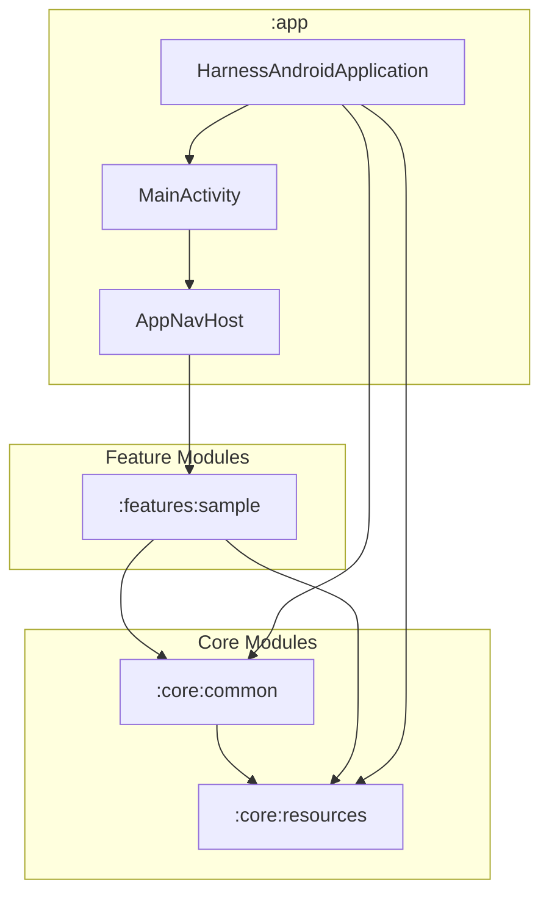
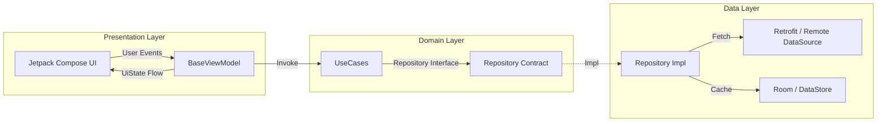

<p align="center">
  
</p>

# HarnessAndroid 🚀

> *"Oval glasses. Impeccable modular boundaries. Clean Architecture that runs on the first build."*

Welcome to **HarnessAndroid** — a production-grade, multi-module Android template crafted for strict architectural compliance, bulletproof testability, and autonomous AI agent workflows. This repository is your battle-tested starting point for building uncompromising Android applications from scratch.

---

## 🏛️ Architecture & System Blueprint

### 1. High-Level System Architecture


### 2. Multi-Module Topology & Dependency Matrix

| Module | Depends On | Description |
| :--- | :--- | :--- |
| **`:app`** | All Core & Feature modules | Entry point, Koin initialization, Central NavHost |
| **`:core:common`** | `:core:resources` | Base abstractions (`BaseViewModel`, `Resource<T>`, `UiText`, safe API calls) |
| **`:core:resources`** | None | Design system (Material 3 Themes, Colors, Typography, Strings) |
| **`:features:*`** | `:core:common`, `:core:resources` | Scalable feature modules (Domain, Data, Presentation). **No horizontal dependencies between features.** |

### 3. Clean Architecture & MVVM + UDF Layer Flow


### 4. Quality Harness & Verification Pipeline


---

## 📐 Core Principles & Design Philosophy

- **Clean Architecture + MVVM + UDF**: Unidirectional Data Flow keeps UI predictable and state mutations ironclad.
- **Strict Modularity**: Zero horizontal coupling between features. Every feature is an isolated vertical slice.
- **Agent-Ready**: Pre-configured with `.agent/` instructions, EARS specs, and specialized skills for autonomous AI agent collaboration.

---

## 🧰 Technology Stack & Bundles

Centralized in `gradle/libs.versions.toml`:
- **Runtime**: Kotlin 2.x, Coroutines & Flow
- **UI**: Jetpack Compose (BOM), Material 3, Material Icons Extended
- **DI**: Koin (`io.insert-koin:koin-androidx-compose`)
- **Networking**: Retrofit 3.x, OkHttp Logging Interceptor
- **Persistence**: Room 2.x, Preferences DataStore 1.3
- **Testing**: JUnit 4, MockK, Coroutines Test, Turbine

---

## ♿ Accessibility & UI Compliance (`accessibility-audit` Skill)

Inclusive design is a first-class citizen in HarnessAndroid. Every UI component developed across feature modules must adhere to accessibility standards enforced via our built-in agent skill (`.agent/skills/accessibility-audit/SKILL.md`):
- **48dp Touch Target Rule**: All interactive elements (buttons, icons with actions, chips) must guarantee a minimum touch target of `48.dp x 48.dp`.
- **Content Descriptions**: Informative images and icon buttons must use explicit string resources (`stringResource(R.string.xxx)`), while purely decorative assets must set `contentDescription = null`.
- **TalkBack Semantics**: Complex cards and list items must group descendants using `Modifier.semantics(mergeDescendants = true)` for screen reader clarity.
- **Scalable Typography**: Use `sp` units for all text to respect system font scaling preferences.

---

## 🛡️ Verification Protocol

Never merge without passing the golden triad:
```bash
./gradlew spotlessApply detekt testDebugUnitTest
```

---

## 🛠️ Guide: Spun-up a New Feature Module

> 💡 **Pro-Tip**: You can create new feature modules **manually** following the steps below, or simply by asking your AI coding agent to generate and wire the feature module for you automatically!

1. **Create Module Directory**: `features/<feature_name>/`
2. **Configure `build.gradle.kts`**:
   ```kotlin
   plugins {
       id("com.android.library")
       alias(libs.plugins.kotlin.compose)
       alias(libs.plugins.kotlin.serialization)
       alias(libs.plugins.spotless)
       alias(libs.plugins.detekt)
   }

   android {
       namespace = "com.harnessandroid.features.<feature_name>"
   }

   dependencies {
       implementation(project(":core:common"))
       implementation(project(":core:resources"))
       implementation(platform(libs.androidx.compose.bom))
       implementation(libs.bundles.common)
       implementation(libs.bundles.compose)
       implementation(libs.bundles.koin)
       debugImplementation(libs.androidx.compose.ui.tooling)

       testImplementation(libs.bundles.test)
       androidTestImplementation(libs.bundles.androidTest)
   }
   ```
3. **Register in `settings.gradle.kts`**: `include(":features:<feature_name>")`
4. **Implement Clean Layers**: Domain, Data, Presentation.
5. **Verify**: Run `./gradlew spotlessApply detekt testDebugUnitTest`.
